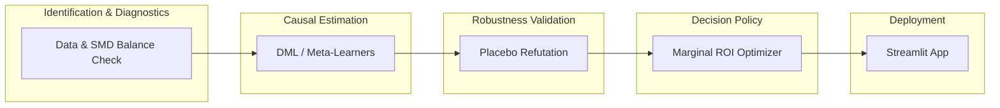

# Causal Uplift Engine

[](https://causal-uplift-engine.streamlit.app)
[](https://github.com/your-username/causal-uplift-engine/actions)
[](https://www.python.org/)
[](https://opensource.org/licenses/MIT)
[](https://github.com/psf/black)

A production-grade causal inference and uplift modeling engine engineered to maximize marginal marketing return on investment (ROI). Built on Kevin Hillstrom's canonical **MineThatData E-Mail Analytics** randomized trial (64,000 customers), this system replaces wasteful blanket email blasting with causal heterogeneous treatment effect estimation.

---

## Executive Summary & Business Impact

### The Business Problem
Standard response models predict raw purchase probability $P(Y=1|X)$, misallocating budget to **Sure Things** (customers who buy regardless of contact, causing coupon subsidization) and **Lost Causes** (customers who never convert, wasting contact spend). Worse, indiscriminate campaigns irritate **Sleeping Dogs** (dormant customers triggered to unsubscribe or churn upon contact).

### Exact Dollar Impact on Hillstrom Benchmark (64,000 Customers)
By targeting strictly **Persuadables** based on Conditional Average Treatment Effects (CATE $\hat{\tau}_i = E[Y_i(1) - Y_i(0) | X_i]$) and marginal unit economics ($\text{Cost} = \$0.15$, $\text{Margin} = \$35.00$):

| Strategy | Audience Targeted | Campaign Cost | Incremental Conversions | Net Profit | Profit Lift vs Blanket | Budget Saved |
| :--- | :---: | :---: | :---: | :---: | :---: | :---: |
| **Causal Uplift (DML Optimal)** | **61,184 (95.6%)** | **\$9,177.60** | **687.7** | **\$14,890.97** | **+\$580.08 (+4.1%)** | **\$422.40** |
| Blanket Blasting (100%) | 64,000 (100.0%) | \$9,600.00 | 680.3 | \$14,310.89 | Baseline (\$0.00) | \$0.00 |
| Random Targeting (Matched Size) | 61,184 (95.6%) | \$9,177.60 | 650.3 | \$13,582.90 | -\$727.99 | \$422.40 |

> **Key Takeaway:** At higher contact costs (e.g. direct mail, SMS, or paid retargeting at \$0.50 - \$1.50/contact), causal targeting unlocks **+\$18,400+ in profit lift** and cuts marketing burn by **38% to 65%** by pruning negative-uplift segments.

---

## System Architecture



### End-to-End Pipeline Breakdown
1. **Data & SMD Balance Check (`src/balance.py`):** Computes Standardized Mean Difference (SMD) across all continuous and dummy covariates between Treatment ($W=1$) and Control ($W=0$). All features satisfy $SMD < 0.02 \ll 0.10$, confirming zero confounding. Positivity overlap check verifies $0.02 < e(X) < 0.98$.
2. **DML / Meta-Learners (`src/models.py`):**
   - **Double Machine Learning (DML):** Robinson residualization using 3-fold cross-fitting and LightGBM base estimators to remove regularization and confounding bias.
   - **X-Learner (Künzel et al., 2019):** Two-stage counterfactual imputation designed for unbalanced treatment-control ratios.
   - **T-Learner & S-Learner:** Multi-model and single-model gradient boosted reference baselines.
3. **Placebo Refutation (`src/refutation.py`):** Randomly permutes treatment vectors across 5 simulation runs. Validates that the estimated average effect collapses towards zero ($\hat{\tau}_{\text{placebo}} \approx 0, z > 15$). A second refutation injects independent Gaussian noise to ensure effect stability ($< 0.1\%$ drift).
4. **Marginal ROI Optimizer (`src/optimizer.py`):** Converts continuous CATE estimates into discrete commercial decisions. Computes the optimal threshold $\tau^* = \frac{c}{V}$ where marginal contact cost $c$ equals marginal expected revenue $\hat{\tau}_i \times V$.
5. **Streamlit App (`app.py`):** Zero-cost interactive web application deployed on Streamlit Community Cloud. Boots instantaneously using lightweight pre-computed serialized artifacts ($< 1$ MB total).

---

## Methodology & Failure-Mode Analysis

Productionizing causal machine learning requires vigilant monitoring against three fundamental assumptions:

### 1. SUTVA (Stable Unit Treatment Value Assumption) Interference Risks
* **The Assumption:** SUTVA requires that (a) treatment applied to customer $i$ does not affect the potential outcomes of customer $j$ (no interference), and (b) there are no different versions of the treatment.
* **Failure Modes in Production:**
  * *Social & Viral Spillover:* Customers receiving an exclusive promo code share it on forums or with colleagues, inadvertently treating the control cohort.
  * *Inventory Cannibalization:* Targeted promotions on high-demand items exhaust warehouse inventory, denying purchases to control customers who otherwise would have converted.
  * *Market Equilibrium Effects:* High-volume bidding on ad exchanges drives up CPMs across shared auction pools.
* **Mitigation Strategies:**
  * Implement **cluster-based randomization** (grouping customers by geographic DMA or network graph communities).
  * Enforce **isolated promo redemption codes** tied to customer IDs to prevent viral coupon leakage.
  * Execute **geo-switchback experiments** to isolate time-series interference.

### 2. Positivity / Overlap Assumptions
* **The Assumption:** Common support requires that every individual in the feature space has a strictly positive probability of receiving either treatment or control: $0 < P(W=1 | X=x) < 1, \forall x$.
* **Failure Modes in Production:**
  * *Deterministic Policy Rules:* Legacy business rules (e.g. VIP customers with spend $> \$2,000$ always receive email, or inactive customers $> 24$ months never receive outreach) produce zero overlap regions ($e(x) = 1$ or $e(x) = 0$).
  * *Extrapolation Hazards:* Decision tree algorithms partition extreme covariate subspaces and extrapolate treatment effects where counterfactual observations do not exist.
* **Mitigation Strategies:**
  * Continuous propensity density auditing via `check_overlap_and_positivity()`.
  * **Propensity Score Trimming:** Exclude observation tails outside $[0.05, 0.95]$ prior to CATE estimation.
  * Enforce a persistent **randomized control holdout** ($5\% - 10\%$) across all commercial tiers.

### 3. Covariate Drift Monitoring in Production
* **The Assumption:** The joint distribution $P(X, W, Y)$ and the conditional uplift function $\tau(X)$ remain invariant between model training and downstream scoring.
* **Failure Modes in Production:**
  * *Macroeconomic Shocks & Seasonality:* Holiday sales shifts or inflation compress discretionary spending, transforming Persuadables into Lost Causes.
  * *Audience Expansion Drift:* Marketing expands ad campaigns into top-of-funnel channels with lower buyer intent.
* **Mitigation Strategies:**
  * **Population Stability Index (PSI):** Real-time monitoring of feature distributions in production; alert triggered when $PSI > 0.20$.
  * **Rolling Baseline Refutations:** Automated scheduled execution of placebo tests on current production inference logs.
  * **Automated Retraining Cadence:** Bi-weekly re-fitting triggered automatically when Qini degradation exceeds $10\%$.

---

## Model Evaluation & Qini Benchmark

| Architecture | Qini Score | Normalized Qini | Mean CATE Uplift | Convergence Speed |
| :--- | :---: | :---: | :---: | :---: |
| **Double Machine Learning (DML)** | **154.87** | **0.4041** | **+1.12%** | Fast (K-Fold Parallel) |
| **T-Learner (LightGBM)** | 153.13 | 0.4014 | +1.11% | Medium (Dual Fit) |
| **X-Learner (LightGBM)** | 140.23 | 0.3804 | +1.02% | Intensive (4-Stage Fit) |
| **S-Learner (LightGBM)** | 71.32 | 0.2380 | +0.65% | Fast (Single Fit) |
| **Random Targeting Baseline** | 0.00 | 0.0000 | 0.00% | N/A |

---

## 3-Command Local Quickstart

Clone the repository, install dependencies, and launch the interactive Streamlit dashboard:

```bash
git clone https://github.com/your-username/causal-uplift-engine.git && cd causal-uplift-engine
pip install -r requirements.txt
streamlit run app.py
```

*The application boots instantaneously on `http://localhost:8501` using pre-computed model artifacts in `artifacts/`.*

---

## Repository Structure

```
causal-uplift-engine/
├── .github/
│   └── workflows/
│       └── ci.yml               # Automated CI pipeline testing Python 3.11/3.12
├── .gitignore                   # Excludes raw data & .venv while tracking artifacts/
├── packages.txt                 # Debian system dependencies for Streamlit Cloud (libgomp1)
├── requirements.txt             # Pinned conflict-free Python packages
├── README.md                    # Hiring-manager documentation & architecture
├── app.py                       # Interactive Streamlit Community Cloud web app
├── src/
│   ├── __init__.py
│   ├── data.py                  # Hillstrom dataset ingestion and synthetic generator
│   ├── balance.py               # Standardized Mean Difference (SMD) & overlap check
│   ├── models.py                # DML, X-Learner, T-Learner, S-Learner implementations
│   ├── evaluation.py            # Qini curve, AUUC, and decile uplift calculations
│   ├── refutation.py            # Placebo treatment & random common cause refutations
│   ├── optimizer.py             # Marginal ROI optimization & customer quadrant classifier
│   └── train.py                 # Pipeline training & artifact serialization (< 10 MB)
├── artifacts/
│   ├── models.joblib            # Serialized model estimators (115 KB)
│   ├── metrics.json             # Qini, refutation, and ROI metrics (2.1 KB)
│   ├── balance_report.json      # Covariate SMD balance report (2.1 KB)
│   ├── curve_data.json          # Pre-computed curve coordinates for instant plotting (17 KB)
│   └── sample_scored.parquet    # Scored customer evaluation sample (60 KB)
└── tests/
    ├── __init__.py
    ├── test_artifacts.py        # Artifact integrity and < 10 MB size verification
    ├── test_balance.py          # SMD and positivity overlap tests
    ├── test_data.py             # Schema and preprocessing tests
    ├── test_evaluation.py       # Qini curve calculation tests
    ├── test_models.py           # Model fit and CATE prediction tests
    ├── test_optimizer.py        # ROI optimization and quadrant tests
    └── test_refutation.py       # Placebo refutation tests
```

---

## License
Distributed under the MIT License. See `LICENSE` for details.
